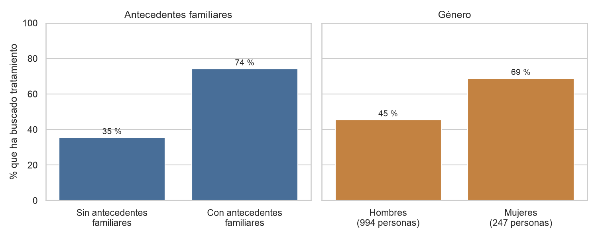
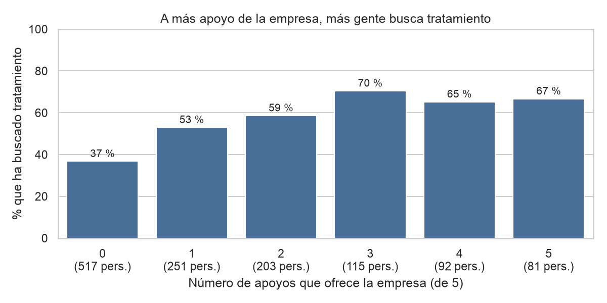
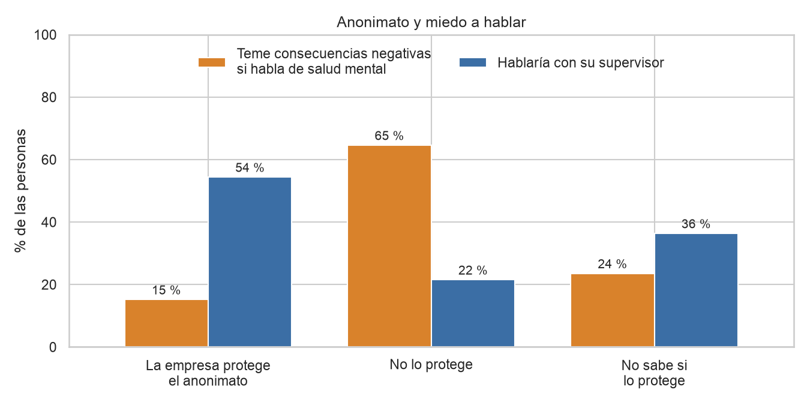
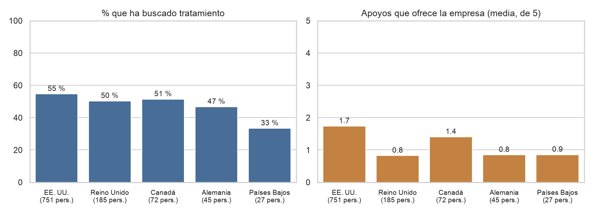

# Salud mental en el sector tecnológico: informe ejecutivo

**Qué analizamos:** 1259 respuestas de la encuesta de OSMI sobre salud mental en el trabajo del sector tecnológico (2014-2016). La pregunta central es: **¿quién ha buscado tratamiento por un problema de salud mental, y qué lo acompaña?** Cerca de la mitad de las personas (51 %) dice que sí lo ha buscado.

> Todos los porcentajes se calculan dentro de cada grupo. Lo que mostramos son **relaciones** entre respuestas, no causas: que dos cosas vayan juntas no prueba que una provoque la otra.

---

## 1. Los antecedentes familiares son lo que más se relaciona con buscar tratamiento

- Entre quienes tienen antecedentes familiares de salud mental, **el 74 %** ha buscado tratamiento. Entre quienes no los tienen, **el 36 %**: casi el doble.
- Las mujeres lo buscan bastante más que los hombres (**69 % frente a 45 %**).
- La edad, el tamaño de la empresa y trabajar en remoto cambian muy poco el resultado.

*Precaución:* el grupo de personas trans, no binarias u otras identidades tiene solo 14 respuestas. Sus resultados no se pueden comparar con los de los grupos grandes y no los mostramos en el gráfico.

---

## 2. Cuanto más apoyo ofrece la empresa, más gente busca tratamiento

Contamos cuántos de estos 5 apoyos ofrece cada empresa: beneficios de salud mental, información sobre opciones de atención, un programa de bienestar, recursos para pedir ayuda y protección del anonimato.

- Con **ningún apoyo**, el **37 %** ha buscado tratamiento. Con **3 apoyos**, el **70 %**.
- A partir de 3 apoyos el porcentaje deja de subir (entre el 65 % y el 70 %).
- Quien no sabe si su empresa ofrece estos recursos («no sé») es quien menos busca tratamiento.

*Precaución:* puede ser también al revés: quien busca tratamiento acaba conociendo mejor los recursos de su empresa. Los grupos con 4 y 5 apoyos son pequeños (92 y 81 personas).

---

## 3. Proteger el anonimato va unido a menos miedo a hablar

- Donde la empresa **protege el anonimato**, solo el **15 %** teme consecuencias negativas por hablar de salud mental; donde **no lo protege**, el **65 %**.
- El **54 %** hablaría con su supervisor en las primeras, frente al **22 %** en las segundas.
- Con los compañeros la diferencia es mucho menor: la respuesta más común es «depende de quién».

*Precaución:* solo 65 personas dicen que su empresa no protege el anonimato, así que esas cifras son orientativas. Y **el 65 % (819 personas) no sabe** si se protege su anonimato.

---

## 4. Los países se parecen en quién busca tratamiento, aunque no en el apoyo

En los cuatro países con más de 30 respuestas, entre el **47 % y el 55 %** de las personas ha buscado tratamiento. Las empresas de EE. UU. y Canadá ofrecen más apoyos que las de Reino Unido, Alemania y Países Bajos, pero eso no se traduce en grandes diferencias entre países.

*Precaución:* Alemania (45 personas) y Países Bajos (27) son grupos pequeños. Además, quien responde es distinto según el país (por ejemplo, el 24 % de las respuestas de EE. UU. son de mujeres, frente al 2 % de las de Alemania).

---

## Qué sugieren estos resultados para una empresa

1. **Dar a conocer los recursos que ya existen.** Una parte grande de las personas no sabe si hay beneficios (32 %), programas de bienestar o protección del anonimato (65 %). Quien no lo sabe es quien menos busca ayuda.
2. **Hacer visible la protección de la confidencialidad.** Donde se protege el anonimato, hay menos miedo a hablar.
3. **Dar herramientas a los supervisores.** Es la persona con la que más gente hablaría cuando se siente protegida.

Estas son ideas que sugieren los datos, no efectos demostrados.

---

## Qué hay que tener en cuenta

- **Relaciones, no causas.** No sabemos si el apoyo hace que se busque más ayuda o si quien busca ayuda conoce mejor los recursos.
- **«Ha buscado tratamiento» no es lo mismo que «sufre».** Una persona puede necesitar ayuda y no haberla buscado.
- **La muestra no representa a todo el sector.** El 79 % son hombres y casi el 60 % responde desde EE. UU.
- **Es de una sola época.** El 90 % de las respuestas llegó en agosto de 2014; no podemos ver cambios en el tiempo.
- **Participación voluntaria.** Probablemente respondió más quien tiene interés en el tema.
- **Grupos pequeños.** Con pocas respuestas (14, 27, 45, 56 o 65 personas) los porcentajes cambian mucho con una sola persona.

*Fuente: encuesta «Mental Health in Tech Survey» de OSMI (1259 respuestas tras la limpieza). El análisis completo está en `eda.ipynb`.*
